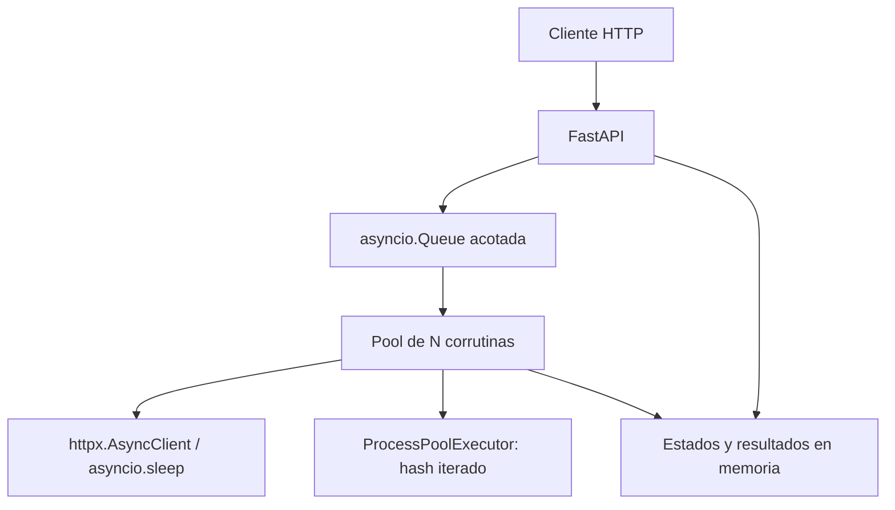

# TP2 — Plataforma de tareas distribuidas

Primer avance de Computación II: API HTTP con una cola en memoria, workers
asíncronos y tres tipos de tarea reales. **Este avance todavía no completa la
consigna.**

## Ejecutar

```sh
docker compose up --build
```

API en http://localhost:8000 y documentación interactiva en
http://localhost:8000/docs. Se usa un único proceso de Uvicorn porque el estado y
la cola viven en memoria: varias instancias tendrían estados independientes.

Para desarrollo local con Python 3.11 o superior:

```sh
python3 -m venv .venv
. .venv/bin/activate
pip install -r requirements.txt
uvicorn app.main:app --host 0.0.0.0 --port 8000
```

## Probar

Crear una espera de cinco segundos. El POST devuelve `202` con el identificador
sin esperar esos cinco segundos:

```sh
curl -X POST http://localhost:8000/tareas \
  -H 'Content-Type: application/json' \
  -d '{"tipo":"esperar","segundos":5}'

curl -X POST http://localhost:8000/tareas \
  -H 'Content-Type: application/json' \
  -d '{"tipo":"hashear","texto":"hola","iteraciones":100000}'

curl -X POST http://localhost:8000/tareas \
  -H 'Content-Type: application/json' \
  -d '{"tipo":"descargar","urls":["https://example.com","https://www.python.org"]}'

curl http://localhost:8000/tareas
curl 'http://localhost:8000/tareas?estado=completada'
curl http://localhost:8000/tareas/REEMPLAZAR_POR_ID
curl http://localhost:8000/estadisticas
```

Estados implementados: `pendiente`, `ejecutando`, `completada` y `fallida`.
Un identificador desconocido devuelve `404`; los parámetros inválidos, `422`;
una cola llena, `503`. Cada descarga devuelve su propio error de red si lo hay;
la tarea contenedora puede quedar completada con errores individuales. Los
códigos HTTP como `404` o `500` se reportan como respuestas recibidas.

## Arquitectura



`WORKERS` configura cuántas tareas se ejecutan a la vez; `PROCESOS_CPU`, cuántos
procesos calculan hashes; `CAPACIDAD_COLA`, cuántas tareas esperan. Los valores
por defecto son 4, 2 y 100. Cada tarea de descarga acepta hasta 20 URLs, y el
cliente HTTP compartido limita las conexiones a 40.

## Decisiones de este avance

- `asyncio.Queue` permite esperar trabajo con `await` sin bloquear el event
  loop. `queue.Queue.get()` es bloqueante y está pensado para threads.
- El POST valida y encola con `put_nowait`: si no hay espacio, informa el error
  en vez de quedarse esperando. Registrar la tarea no contiene ningún `await`;
  el worker no puede consumirla antes de que se registre.
- Los workers son corrutinas, no procesos. Las descargas usan `asyncio.gather`
  para iniciar las URLs concurrentemente. Un `for` con un `await` por URL las
  descargaría secuencialmente.
- `httpx.AsyncClient` se comparte para reutilizar conexiones. Los cuerpos se
  leen por fragmentos para contar bytes sin guardar archivos completos.
- El hash se envía con `run_in_executor` a procesos separados: el cálculo Python
  no ocupa el hilo del event loop y puede usar varios núcleos. Se usa `spawn`
  explícitamente y la función de hash está al nivel del módulo, para poder
  importarla en los procesos hijos.
- Una excepción ordinaria de una tarea se registra y la marca como fallida; el
  worker continúa atendiendo la cola. `task_done()` se ejecuta en `finally`.
- El promedio de estadísticas contempla tareas terminadas, tanto completadas
  como fallidas, y mide ejecución, sin contar espera en la cola.

## Pendiente para los siguientes avances

1. Cancelación de tareas pendientes y en ejecución, estado `cancelada` y
   timeouts por tarea. Cancelar el await de un executor no detiene el cálculo:
   habrá que resolver explícitamente esa limitación.
2. Apagado con límite de tiempo y volcado `estado_<timestamp>.json`; detección
   de un volcado previo al arrancar. Por ahora el cierre drena toda la cola,
   cierra conexiones y termina el pool, pero puede superar el límite de Docker.
3. Las tres mediciones reales: descargas secuenciales/concurrentes, latencia
   de la API con/sin executor y saturación del pool.
4. Informe final: conectar con las clases y completar conclusiones personales.
   Esos párrafos deben reflejar la experiencia del estudiante.

## Limitaciones actuales

El historial crece en memoria y se pierde al reiniciar. No hay autenticación,
persistencia, cancelación ni timeout global por tarea. El timeout de HTTP es
por operación de red, no un límite total de descarga. Las URLs son aportadas
por el cliente, por lo que esta versión se debe ejecutar en un entorno local
controlado, no exponer como servicio público. Las dependencias tienen rangos
de versiones y aún no hay archivo de bloqueo reproducible.

## Verificación

Pruebas con la biblioteca estándar de Python (tras instalar requirements):

```sh
python -m unittest discover -s tests -v
```

Cubren encolado inmediato, concurrencia de workers, recuperación tras un error,
cola llena, descargas con transporte HTTP simulado y el cálculo de hash en un
proceso real. No reemplazan las mediciones obligatorias del informe.

Verificación de este avance: 5 pruebas aprobadas con Python 3.12; sintaxis de
Python y configuración de Compose válidas. No se ejecutó la imagen Docker en
este entorno por falta de acceso al daemon. No hay mediciones de rendimiento
obligatorias realizadas todavía.
