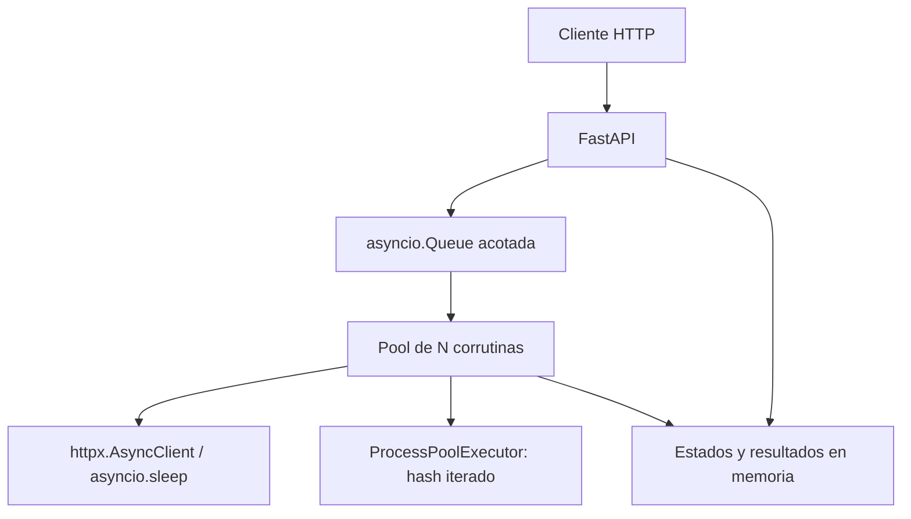

# TP2 — Plataforma de tareas distribuidas

Tercer avance de Computación II: API HTTP con una cola en memoria, workers
asíncronos, cancelación, timeouts, volcado JSON y tres experimentos reproducibles.
El informe técnico incluye resultados de una ejecución local controlada.

## Ejecutar

```sh
docker compose up --build
```

API en http://localhost:8000 y documentación interactiva en
http://localhost:8000/docs. Se usa un único proceso de Uvicorn porque el estado y
la cola viven en memoria: varias instancias tendrían estados independientes.

Para desarrollo local con Python 3.11 o superior:

```sh
python3 -m venv .venv
. .venv/bin/activate
pip install -r requirements.txt
uvicorn app.main:app --host 0.0.0.0 --port 8000
```

## Probar

Crear una espera de cinco segundos. El POST devuelve `202` con el identificador
sin esperar esos cinco segundos:

```sh
curl -X POST http://localhost:8000/tareas \
  -H 'Content-Type: application/json' \
  -d '{"tipo":"esperar","segundos":5}'

curl -X POST http://localhost:8000/tareas \
  -H 'Content-Type: application/json' \
  -d '{"tipo":"hashear","texto":"hola","iteraciones":100000}'

curl -X POST http://localhost:8000/tareas \
  -H 'Content-Type: application/json' \
  -d '{"tipo":"descargar","urls":["https://example.com","https://www.python.org"]}'

curl http://localhost:8000/tareas
curl 'http://localhost:8000/tareas?estado=completada'
curl http://localhost:8000/tareas/REEMPLAZAR_POR_ID
curl http://localhost:8000/estadisticas
```

Estados implementados: `pendiente`, `ejecutando`, `completada`, `fallida` y `cancelada`.
Un identificador desconocido devuelve `404`; los parámetros inválidos, `422`;
una cola llena, `503`. Cada descarga devuelve su propio error de red si lo hay;
la tarea contenedora puede quedar completada con errores individuales. Los
códigos HTTP como `404` o `500` se reportan como respuestas recibidas.

## Arquitectura



`WORKERS` configura cuántas tareas se ejecutan a la vez; `PROCESOS_CPU`, cuántos
procesos calculan hashes; `CAPACIDAD_COLA`, cuántas tareas esperan. Los valores
por defecto son 4, 2 y 100. Cada tarea de descarga acepta hasta 20 URLs, y el
cliente HTTP compartido limita las conexiones a 40.

## Decisiones de diseño

- `asyncio.Queue` permite esperar trabajo con `await` sin bloquear el event
  loop. `queue.Queue.get()` es bloqueante y está pensado para threads.
- El POST valida y encola con `put_nowait`: si no hay espacio, informa el error
  en vez de quedarse esperando. Registrar la tarea no contiene ningún `await`;
  el worker no puede consumirla antes de que se registre.
- Los workers son corrutinas, no procesos. Las descargas usan `asyncio.TaskGroup`
  para iniciar las URLs concurrentemente y esperar su limpieza si alguna falla. Un `for` con un `await` por URL las
  descargaría secuencialmente.
- `httpx.AsyncClient` se comparte para reutilizar conexiones. Los cuerpos se
  leen por fragmentos para contar bytes sin guardar archivos completos.
- El hash se envía con `run_in_executor` a procesos separados: el cálculo Python
  no ocupa el hilo del event loop y puede usar varios núcleos. Se usa `spawn`
  explícitamente y la función de hash está al nivel del módulo, para poder
  importarla en los procesos hijos.
- Una excepción ordinaria de una tarea se registra y la marca como fallida; el
  worker continúa atendiendo la cola. `task_done()` se ejecuta en `finally`.
- El promedio de estadísticas contempla tareas terminadas, completadas,
  fallidas y canceladas que llegaron a ejecutarse, y mide ejecución, sin contar espera en la cola.

## Cancelación, timeouts y apagado

Cada POST acepta `timeout` en segundos (por defecto 30). El límite cuenta desde
que comienza la ejecución, sin incluir la espera en la cola. Si vence, la tarea
pasa a `fallida`, con el motivo en `error`.

```sh
curl -X POST http://localhost:8000/tareas \
  -H 'Content-Type: application/json' \
  -d '{"tipo":"esperar","segundos":20,"timeout":2}'

curl -X DELETE http://localhost:8000/tareas/REEMPLAZAR_POR_ID
```

La cancelación de una tarea pendiente la marca y el worker la saltea cuando
sale de la cola. Esa entrada ocupa espacio hasta ser consumida. La cancelación
de una tarea en ejecución cancela su corrutina hija, conservando el worker.
Cancelar una tarea terminada devuelve su estado sin modificarla.

Las descargas usan `TaskGroup`: ante cancelación o error inesperado se esperan
todas las corrutinas hijas. El contexto del streaming cierra la respuesta.
Para CPU, cancelar el await no detiene un proceso. El cálculo se divide en
bloques de hasta 50.000 iteraciones enviados con `run_in_executor`. Al cancelar
se deja de enviar trabajo y se espera solo el bloque actual antes de liberar
el worker. Los bytes intermedios conservan exactamente el mismo hash iterado.
No se crean ni activan eventos compartidos desde el event loop.

Uvicorn recibe SIGINT/SIGTERM y ejecuta el cierre del lifespan. Se dejan de
aceptar tareas nuevas y se cancelan las pendientes. Las activas tienen hasta
`ESPERA_APAGADO` segundos (10 por defecto) para terminar; luego se cancelan y
se concede hasta 2 segundos a su limpieza, más hasta 2 segundos a los workers.
Se marcan los estados restantes como cancelados y se escribe
`datos/estado_<timestamp>.json` antes de cerrar los recursos. El cliente HTTP
tiene un límite de cierre de 2 segundos; el executor se cierra sin volver a
esperar indefinidamente al cálculo completo. Sus trabajos son bloques cortos.
Compose conserva los volcados en la carpeta del host. Al arrancar se informa
por log si hay un volcado previo; no se restaura ni reejecuta.

Las excepciones ordinarias de una tarea quedan capturadas y no matan al worker.
Si una excepción escapa de la corrutina del propio worker o esta se cancela
inesperadamente, un callback registra su terminación y crea un reemplazo.
Durante el apagado se desactiva esa reposición. Esto repone capacidad, pero
no reintenta automáticamente la tarea fallida ni reconstruye un pool de
procesos roto: esas limitaciones se deben tener presentes.

## Mediciones reproducibles

Desde la raíz del proyecto, con las dependencias instaladas:

```sh
python -m benchmarks.medir
```

También se puede ejecutar dentro de Docker, sin levantar la API normal:

```sh
mkdir -p mediciones
docker compose build
docker compose run --rm --no-deps -v "$PWD/mediciones:/app/mediciones" api python -m benchmarks.medir
```

El comando inicia y cierra servidores temporales en puertos locales libres;
no usa el servicio de puerto 8000 ni sitios de Internet. Guarda muestras y
metadatos en `mediciones/resultados.json`. La variante que bloquea el event loop
existe solo en `benchmarks/servidor.py`; el arranque normal con `app.main:app`
siempre utiliza el executor. Los resultados detallados y la interpretación
están en [mediciones/INFORME.md](mediciones/INFORME.md).

Los datos incluidos se obtuvieron ejecutando Python en este entorno de trabajo,
no dentro de Docker ni en la terminal del estudiante. Son mediciones reales de
HTTP local con una demora controlada; no describen la velocidad de Internet.
Al repetir el experimento, se actualizan automáticamente el JSON, el informe y
las tablas del README. Para regenerar los textos: python -m benchmarks.informe.

### Resultados incluidos

Muestras de la implementación final con bloques de hash.

| Experimento | Resultado |
|---|---:|
| 20 descargas secuenciales (mediana) | 2.0614 s |
| 20 descargas concurrentes (mediana) | 0.1230 s |
| Speedup (cociente de medianas) | 16.76× |
| GET durante hash sin executor (mediana) | 633.988 ms |
| GET durante hash con executor (mediana) | 0.966 ms |

Tres repeticiones de I/O y CPU. HTTP local real con respuestas de 1024 bytes y
100 ms de espera. El hash usa 3.000.000 iteraciones SHA-256. El executor mejora
la respuesta de la API, no necesariamente el tiempo del hash.

| Enviadas | Aceptadas | Rechazadas (503) | Lote (s) | Mediana (s) | p95 (s) | Tareas/s |
|---:|---:|---:|---:|---:|---:|---:|
| 1 | 1 | 0 | 0.159 | 0.151 | 0.151 | 6.31 |
| 4 | 4 | 0 | 0.158 | 0.151 | 0.151 | 25.28 |
| 8 | 8 | 0 | 0.312 | 0.225 | 0.299 | 25.65 |
| 16 | 16 | 0 | 0.624 | 0.372 | 0.594 | 25.66 |
| 32 | 32 | 0 | 1.233 | 0.663 | 1.178 | 25.95 |
| 64 | 64 | 0 | 2.436 | 1.249 | 2.346 | 26.27 |
| 128 | 104 | 24 | 3.960 | 1.998 | 3.694 | 26.26 |

Con cuatro workers y esperas de 150 ms, el techo esperado es 4 / 0,15 ≈ 26,67
tareas/s. Al superar cuatro tareas aparece espera en cola. La capacidad
instantánea es 4 activas + 100 pendientes; no es un máximo universal por lote,
porque pueden terminar tareas mientras llegan otras.

## Conceptos de la materia aplicados

- **Clases 13–14, sockets y servidores concurrentes:** Uvicorn atiende conexiones
  TCP y FastAPI expone las operaciones HTTP. En las mediciones, cliente y
  servidor son procesos distintos comunicados por TCP de loopback.
- **Clase 17, multiplexación:** el event loop puede esperar múltiples sockets
  sin asignar un thread a cada descarga. El mecanismo concreto depende del
  sistema operativo; no se invoca `select` manualmente en la aplicación.
- **Clase 18, corrutinas y event loop:** los `await` de HTTPX y `asyncio.sleep`
  ceden el control. Ejecutar el bucle de hashes en ese hilo impide atender
  otras solicitudes, como muestra el experimento de latencia.
- **Clase 19, HTTP y FastAPI:** Pydantic valida las solicitudes y el POST
  devuelve `202 Accepted`. El cliente consulta luego el recurso por su ID.
- **Clases 20–21, asyncio en red y avanzado:** `asyncio.Queue` implementa
  productor–consumidor; `TaskGroup` administra las descargas hijas;
  `wait_for` combina límite temporal con cancelación y limpieza.
- **Clase 22, concurrent.futures:** `ProcessPoolExecutor` aísla el cálculo
  intensivo y `run_in_executor` lo integra con el event loop. Los bloques
  cortos permiten detener el envío de trabajo al cancelar.
- **Bloque 0, context managers:** `lifespan`, `async with client.stream(...)`
  y `try/finally` definen cuándo abrir y cerrar recursos.

No hace falta un lock para registrar una tarea porque no hay `await` entre la
inserción en la cola y su registro. Esto no vuelve atómicas todas las funciones
async: cada `await` permite que otra corrutina avance. El estado de tareas se
modifica en el hilo del event loop; los procesos calculan bloques de hash y devuelven
los bytes intermedios.

Con 10.000 solicitudes de golpe, una vez ocupados los workers y los 100 lugares
de la cola, el POST responde `503`. Eso evita una cola ilimitada, pero no limita
el historial: las tareas terminadas siguen ocupando memoria. El listado y las
estadísticas recorren ese historial, lo cual también aumenta su costo.

## Limitaciones actuales

El historial crece en memoria y no se restaura al reiniciar. No hay autenticación.
La espera de tareas y workers durante el cierre está acotada. Un bloqueo del
sistema operativo o del disco puede impedir terminar un proceso o escribir el
volcado: no hay una garantía absoluta frente a fallos del sistema.
Las URLs son aportadas por el cliente: esta versión se debe usar en un entorno
local controlado, no como servicio público. Las dependencias tienen rangos de
versiones y aún no hay archivo de bloqueo reproducible.

## Verificación

Tras instalar requirements:

```sh
python -m unittest discover -s tests -v
```

Las pruebas cubren encolado inmediato, concurrencia, recuperación tras errores,
cola llena, descargas simuladas, hash en proceso real, cancelación pendiente y
en ejecución, cancelación y timeout de CPU, cierre de streaming, timeout de
espera, apagado con cancelación y volcado JSON, y detección del volcado previo.
Las 13 pruebas pasaron en esta copia. La configuración de Compose se validó.
El usuario también comprobó el arranque del contenedor y la respuesta HTTP de
`GET /estadisticas` desde el host.

## Lo que aprendí

Este trabajo me ayudó a entender la diferencia entre concurrencia y paralelismo.
En las descargas, `asyncio` permite aprovechar el tiempo de espera para avanzar
con otras operaciones. En cambio, el cálculo de hashes necesita ejecutarse
fuera del hilo del event loop para que la API siga respondiendo. Las mediciones
permitieron observar esa diferencia con números.

Otro aprendizaje fue que cancelar una tarea requiere cuidar los recursos que
está utilizando. En las descargas hay que cerrar las respuestas y detener las
corrutinas hijas. En las tareas de CPU, cancelar el `await` no detiene
automáticamente el proceso. Dividir el hash en bloques permite dejar de enviar
trabajo y esperar únicamente el bloque en curso.

También comprendí la importancia de medir y probar el comportamiento del
sistema. Tener más tareas pendientes no significa ejecutar más tareas al mismo
tiempo: al ocuparse los workers, aumenta la espera en la cola. Las pruebas de
cancelación, los timeouts y el apagado ordenado permitieron revisar situaciones
que no aparecen cuando solamente se comprueba que una tarea termina
correctamente.
